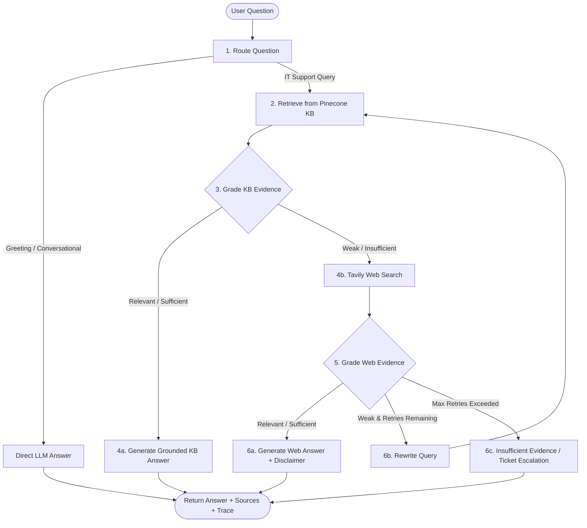

# Enterprise IT Support Agentic RAG Copilot

An enterprise-ready, Forward Deployed Engineering (FDE) Agentic RAG application that transforms static internal documentation into an intelligent, autonomous IT service copilot. 

Built with **LangGraph**, **FastAPI**, **Pinecone Serverless**, **OpenRouter / Gemini**, **Tavily Web Search**, and a modern dark-themed web interface.

---

## 1. Business Problem & Solution

### The Challenge
Internal enterprise IT support teams maintain extensive documentation across disparate systems:
* VPN and remote access setups
* Password reset and MFA policies
* Laptop troubleshooting guides
* Software installations and access privileges
* Security runbooks and compliance policies

Despite having documentation, employees flood service desks with repetitive support tickets because:
1. Keyword searches return fragmented or outdated results.
2. Traditional chatbots hallucinate or fabricate troubleshooting instructions.
3. Standard RAG pipelines cannot recognize when internal documents lack sufficient context to answer the question.
4. Outages or vendor issues (e.g., Microsoft 365, Slack, Zoom) require live public web information that internal documentation cannot supply.

### The Agentic Solution
Unlike naive RAG pipelines that execute a rigid `Retrieve → Generate` sequence, this **Agentic RAG Copilot** makes autonomous, stateful decisions:
- **Private Knowledge First**: Prioritizes verified internal company policies stored in Pinecone vector search.
- **Evidence Verification**: Evaluates retrieved document relevance before answering to avoid hallucinations.
- **Dynamic Web Fallback**: Triggers Tavily web search only when private documentation is insufficient (e.g., third-party outages).
- **Query Rewriting & Retry Guard**: Reformulates ambiguous queries and retries retrieval up to a bounded retry limit.
- **Audit Logging**: Persists every query, source classification, and execution trace to an internal audit database.
- **Self-Service Ingestion**: Allows authorized IT staff to index `.pdf`, `.docx`, `.md`, and `.txt` files directly through the UI.

---

## 2. Agentic RAG Workflow Architecture



### LangGraph Workflow Nodes:
1. **`route_question`**: Fast-paths standard conversational greetings (`hi`, `hello`) directly to the LLM, and routes IT technical inquiries to internal vector search.
2. **`retrieve_kb`**: Embeds queries via high-dimensional vector embeddings and retrieves top-$k$ relevant chunks from Pinecone with connection pooling.
3. **`grade_kb_evidence`**: Validates cosine relevance and keyword overlap to verify the retrieved chunks answer the prompt.
4. **`web_search`**: Falls back to Tavily search to fetch external vendor information.
5. **`grade_web_evidence`**: Evaluates web search results for factual relevance.
6. **`rewrite_query`**: Intelligently expands and refines the query for another search attempt if initial evidence was weak.
7. **`generate_kb_answer` / `generate_web_answer`**: Synthesizes grounded answers citing specific internal document files or external web URLs.
8. **`audit`**: Persists question, source used (`kb`, `web`, `direct`), and execution trace into SQLite (`data/audit.db`).

---

## 3. Technology Stack

| Layer | Technology | Purpose |
| :--- | :--- | :--- |
| **Agent Orchestration** | [LangGraph](https://github.com/langchain-ai/langgraph) & [LangChain](https://github.com/langchain-ai/langchain) | Stateful agentic workflow, conditional branching, retry loops |
| **LLM Inference** | [OpenRouter](https://openrouter.ai/) / [Google Gemini](https://ai.google.dev/) | High-speed response generation (`nvidia/nemotron-3.5-lightning:free`, `gemini-2.5-flash`) |
| **Embeddings** | [Google Generative AI Embeddings](https://ai.google.dev/) (`gemini-embedding-001`) | High-dimensional (3072d) semantic vector embeddings |
| **Vector Store** | [Pinecone Serverless](https://www.pinecone.io/) | Managed cloud vector database for enterprise document search |
| **External Search** | [Tavily AI](https://tavily.com/) | Real-time web search fallback for external vendor outages and live guides |
| **Backend API** | [FastAPI](https://fastapi.tiangolo.com/) + [Uvicorn](https://www.uvicorn.org/) | Async REST API, CORS middleware, Jinja2 templates |
| **Document Ingestion** | `pypdf`, `python-docx`, `langchain-text-splitters` | Resilient PDF, Word, Markdown, and text parsing |
| **Audit Database** | SQLite (`data/audit.db`) | Query tracking and trace history |
| **Frontend UI** | HTML5, CSS3, Vanilla JS | Sleek dark-mode 3-column UI, real-time agent trace panel, modal uploader |

---

## 4. Project Directory Structure

```text
Enterprise-IT-support-Agentic-Rag-Copilot/
│
├── app/
│   ├── api/
│   │   ├── __init__.py
│   │   └── router.py              # REST API endpoints (/chat, /ingest, /health)
│   ├── core/
│   │   ├── __init.py
│   │   ├── config.py              # Pydantic environment settings & singleton
│   │   └── logging.py             # System logger configuration
│   ├── rag/
│   │   ├── __init__.py
│   │   ├── state.py               # TypedDict agent state & decision schemas
│   │   ├── vectorstore.py         # Pinecone connection pooling & retriever
│   │   └── workflow.py            # LangGraph workflow compilation & execution
│   ├── services/
│   │   ├── __init__.py
│   │   ├── audit.py               # SQLite audit persistence
│   │   └── ingestion.py           # Multi-format document parser & chunker
│   └── main.py                    # FastAPI entrypoint, static & template mounts
│
├── data/
│   ├── sample_kb/                 # Base IT support handbooks & guides
│   │   ├── company-it-handbook.md
│   │   └── It-service-handbook.md
│   └── audit.db                   # SQLite query audit trail
│
├── static/
│   ├── css/
│   │   └── style.css              # Dark theme styling, layout grid, and badges
│   └── js/
│       └── app.js                 # Chat interactions, modal logic, trace renderer
│
├── templates/
│   └── index.html                 # 3-column UI: Sidebar, Chat Area, Trace Monitor
│
├── uploads/                       # Temporary storage for uploaded documents
├── .env.example                   # Environment variable template
├── .gitignore                     # Git ignore rules (.env, venv, caches)
├── ingest_sample_kb.py            # Bulk indexing script for sample documents
├── requirements.txt               # Python package dependencies
├── run.py                         # Application launcher script
└── README.md                      # Project documentation
```

---

## 5. Prerequisites & Environment Setup

### 1. Prerequisites
* Python 3.10, 3.11, or 3.12
* A [Pinecone](https://www.pinecone.io/) account and API key
* An [OpenRouter](https://openrouter.ai/) account and API key (or Google Gemini API key)
* A [Tavily](https://tavily.com/) API key (for web search fallback)

### 2. Clone the Repository
```bash
git clone https://github.com/Sunil032003/Enterprise-IT-support-Agentic-Rag-Copilot.git
cd Enterprise-IT-support-Agentic-Rag-Copilot
```

### 3. Create and Activate a Virtual Environment
**Windows (PowerShell):**
```powershell
python -m venv venv
.\venv\Scripts\Activate.ps1
```

**macOS / Linux:**
```bash
python3 -m venv venv
source venv/bin/activate
```

### 4. Install Dependencies
```bash
pip install -r requirements.txt
```

### 5. Configure Environment Variables
Copy the example configuration to `.env`:
```bash
cp .env.example .env
```

Open `.env` and fill in your API credentials:

```dotenv
# ==============================================================================
# LLM Provider Configuration ("openrouter" or "gemini")
# ==============================================================================
LLM_PROVIDER=openrouter

# OpenRouter API Configuration
OPENROUTER_API_KEY="sk-or-v1-your-openrouter-key-here"
OPENROUTER_MODEL="nvidia/nemotron-3.5-lightning:free"

# Google Gemini API Configuration (Used for Pinecone embeddings)
GEMINI_API_KEY="your-gemini-api-key-here"
GEMINI_MODEL=gemini-2.5-flash
EMBEDDING_MODEL=gemini-embedding-001

# Pinecone Vector Database Configuration
PINECONE_API_KEY="pcsk_your-pinecone-api-key-here"
PINECONE_INDEX_NAME="sample-knowledgebase"
PINECONE_NAMESPACE="company-it-support"

# External Web Search (Tavily)
TAVILY_API_KEY="tvly-your-tavily-api-key-here"

# Document Upload & Administration Key
ADMIN_API_KEY="change me"
```

> **Security Note**: Never commit your `.env` file to Git. It is automatically ignored by `.gitignore`.

---

## 6. How to Run the Application

### Step 1: Ingest Initial Knowledge Base
Before starting the server, seed your Pinecone vector database with the company's internal IT handbooks:
```bash
python ingest_sample_kb.py
```
*Output:*
```text
Total chunks to add: 87
Successfully ingested sample KB into Pinecone!
```

### Step 2: Start the Web Server
Launch the application using either of the following commands:

**Option A (Using runner script):**
```bash
python run.py
```

**Option B (Using Uvicorn directly):**
```bash
uvicorn app.main:app --host 127.0.0.1 --port 8000 --reload
```

### Step 3: Access the Application
* **Web UI**: Open [http://127.0.0.1:8000](http://127.0.0.1:8000) in your browser.
* **Interactive OpenAPI Docs**: Visit [http://127.0.0.1:8000/docs](http://127.0.0.1:8000/docs).

---

## 7. Interactive UI & User Guide

The web application features an intuitive, 3-column layout:

1. **Left Sidebar**:
   - Project overview and badge.
   - Interactive breakdown of the 6-step LangGraph workflow.
   - **`+ Add Company Document`** button to launch the ingestion modal.

2. **Center Chat Area**:
   - Pre-configured quick-prompt buttons for instant testing.
   - Conversational bubbles clearly separating User messages from Assistant responses.
   - Grounded citations linking directly to the source document or search origin.
   - Source badge (`KB`, `TAVILY WEB SEARCH`, `DIRECT`).

3. **Right-Hand Agent Trace Panel**:
   - Displays real-time decision logs produced by LangGraph (e.g., `Routed to: kb`, `Retrieved 3 docs from Pinecone KB`, `KB Evidence verified relevant`).
   - Shows the final resolved source.

---

## 8. Adding New Company Documents (Self-Service Ingestion)

Authorized team members can upload internal documents dynamically without restarting the server:

1. Click **`+ Add Company Document`** in the sidebar.
2. In the modal:
   - Enter the **Admin API Key** (configured as `"change me"` in `.env`).
   - Select a `.pdf`, `.docx`, `.md`, or `.txt` file.
   - Click **Index Document**.
3. The server runs the ingestion pipeline:
   - Resilient stream reading (handles corrupt and standard PDFs).
   - Text extraction and Recursive Character Chunking (chunk size: 1000, overlap: 200).
   - High-dimensional vector embedding.
   - Upsert into Pinecone under the configured namespace.
4. The document is **immediately searchable** in subsequent queries.

---

## 9. REST API Reference

### 1. Health Check
* **Endpoint**: `GET /api/health`
* **Response**:
```json
{
  "status": "ok",
  "service": "Enterprise IT Support Agentic RAG Copilot"
}
```

---

### 2. Chat with the Agent
* **Endpoint**: `POST /api/chat`
* **Headers**: `Content-Type: application/json`
* **Request Body**:
```json
{
  "question": "How do I connect to the company VPN from home?"
}
```
* **Success Response (200 OK)**:
```json
{
  "answer": "To connect to the company VPN from home, follow these steps:\n1. Open the company-approved VPN client...\n2. Authenticate using your corporate email and password...",
  "source_used": "kb",
  "trace": [
    "Fast keyword route to internal KB",
    "Retrieved 3 docs from Pinecone KB.",
    "KB Evidence verified relevant (3 docs matched)"
  ],
  "citations": [
    "data/sample_kb/company-it-handbook.md"
  ]
}
```

---

### 3. Ingest a Document
* **Endpoint**: `POST /api/ingest`
* **Headers**:
  * `X-Admin-Key: change me`
  * `Content-Type: multipart/form-data`
* **Form Data**:
  * `file`: Uploaded file (`.pdf`, `.docx`, `.md`, `.txt`)
* **Success Response (200 OK)**:
```json
{
  "status": "success",
  "message": "Successfully ingested network_troubleshooting.pdf",
  "file": "network_troubleshooting.pdf",
  "chunks": 12
}
```

---

## 10. Verification & Test Scenarios

Try these queries in the interface to verify all agentic decision paths:

| Query Type | Example Prompt | Expected Path |
| :--- | :--- | :--- |
| **Conversational Greeting** | *"Hello, who are you?"* | Fast-path routing → Direct LLM response (No vector or web call) |
| **Internal Policy (Private KB)** | *"How do I connect to the company VPN?"* | Route KB → Pinecone Retrieval → Relevance Grade (Good) → Grounded KB Answer |
| **Security Rule** | *"Can IT support ask for my MFA code?"* | Route KB → Pinecone Retrieval → Grounded answer stating MFA codes are strictly confidential |
| **External Live Information** | *"What is the latest status on Microsoft Teams outage?"* | Route KB → Retrieval Weak → Tavily Web Search → Grounded Web Answer with search citation |
| **Vague / Complex Query** | *"My app is crashing with error 0x8004"* | Route KB → Grade Weak → Tavily Fallback → Query Rewrite → Re-evaluate |

---

## 11. Troubleshooting & FAQs

### Q: Why do I see `OpenRouter Daily Free Limit Exceeded (429)`?
**A**: Free tier models on OpenRouter have a limit of 50 requests per day per account. When this quota is reached:
* Add \$5 credits to your OpenRouter account to unlock 1,000 requests per day.
* Or generate a new API key from a secondary free account and update `OPENROUTER_API_KEY` in `.env`.

### Q: Why do I get a port conflict error (`[Errno 10048] address already in use`)?
**A**: Another instance of Uvicorn is holding port 8000. Terminate the existing process:
* **Windows (PowerShell)**:
  ```powershell
  Get-NetTCPConnection -LocalPort 8000 | ForEach-Object { Stop-Process -Id $_.OwningProcess -Force }
  ```
* **macOS / Linux**:
  ```bash
  kill -9 $(lsof -t -i:8000)
  ```

### Q: Can I run this with Docker?
**A**: Yes. Build and run the container:
```bash
docker build -t it-support-copilot .
docker run -p 8000:8000 --env-file .env it-support-copilot
```

---

## 12. License

This project is licensed under the MIT License — see the [LICENSE](LICENSE) file for details.
